<p align="center">
  
</p>

<p align="center">
  
</p>

<p align="center">
  
</p>

<p align="center">
  
  
  
</p>

---

### 👋 About me

```js
const perarasu = {
  study:     "B.E. Computer Science (IoT) · Sethu Institute of Technology, India · 2027",
  work:      "Partner · White Whale Digital Marketing & Business Solutions",
  builds:    ["Client websites", "AI prototypes", "RAG apps", "Computer vision"],
  security:  ["Burp Suite", "Nmap", "CRTOM certified", "CCEP certified"],
  learning:  ["Core Python", "React + TypeScript", "Japanese (JLPT N4)"],
  goal:      "A tech career in Japan 🇯🇵"
};
```

### 🛠️ What I do

- 🌐 **Front-end & web:** I build client websites end to end as a partner at White Whale Digital Marketing & Business Solutions.
- 🤖 **AI prototypes:** built with AI-assisted development, including fire safety detection, cleanliness monitoring, RAG Q&A and language translation.
- 🛡️ **Security & testing:** web app testing with Burp Suite and Nmap · CRTOM & CCEP certified.

### 🧰 Tech stack

<p align="center">
  
</p>

<p align="center">
  
  
  
  
  
  
</p>

### 🚀 Featured projects

My own products, designed and built by me. Available for clients through White Whale.

| Project | What it does | Stack |
|---|---|---|
| 🔥 [**IgnisGuard**](https://github.com/perarasuboopathirajanm/IgnisGuard) | Fire, smoke & PPE (helmet / fire jacket) detection with an in-browser YOLO training studio | FastAPI · YOLO11 · YOLO-World |
| 📚 [**ResearchAI-RAG**](https://github.com/perarasuboopathirajanm/ResearchAI-RAG) | Private RAG research assistant: upload papers, get cited answers, runs locally | FastAPI · React · ChromaDB · Ollama |
| 📸 [**SnapFind-Studio**](https://github.com/perarasuboopathirajanm/SnapFind-Studio) | Event photo delivery by face: scan a QR, take a selfie, get your photos | FastAPI · OpenCV |
| 🛰️ [**SatQuery AI**](https://github.com/perarasuboopathirajanm/SatQueryAI-frontend) | Smart India Hackathon 2026 prototype: ask questions about satellite images ([backend](https://github.com/perarasuboopathirajanm/SatQueryAI-backend)) | React · Vite · FastAPI |
| ✦ [**CaptionCraft**](https://github.com/perarasuboopathirajanm/ai-caption-generator) | Upload a photo and get ready-to-post captions and hashtags for Instagram, LinkedIn, X and Facebook ([live demo](https://perarasuboopathirajanm.github.io/ai-caption-generator/)) | JavaScript · Claude Vision |
| ⛨ [**ShieldKit**](https://github.com/perarasuboopathirajanm/shieldkit) | Browser security toolkit: password audit + breach check, phishing URL analyzer, hash identifier, JWT inspector ([live demo](https://perarasuboopathirajanm.github.io/shieldkit/)) | JavaScript · Web Crypto · HIBP API |

### 🏆 Highlights

- 🥇 **1st Prize**, 11:11 national-level hackathon (2026)
- 🥈 **2nd Prize**, MAD AI SDG Ideathon (2024)
- 🛡️ **CRTOM** & **CCEP** certified

### 📊 GitHub stats

<p align="center">
  
  
</p>

<p align="center">
  
</p>

<p align="center">
  
</p>

### 🐍 Contribution snake

<p align="center">
  <picture>
    <source media="(prefers-color-scheme: dark)" srcset="https://raw.githubusercontent.com/perarasuboopathirajanm/perarasuboopathirajanm/output/github-snake-dark.svg" />
    <source media="(prefers-color-scheme: light)" srcset="https://raw.githubusercontent.com/perarasuboopathirajanm/perarasuboopathirajanm/output/github-snake.svg" />
    
  </picture>
</p>

### 🏅 Trophies

<p align="center">
  
</p>

### 📫 Let's connect

<p align="center">
  <a href="mailto:perarasuboopathirajan@gmail.com"></a>
  <a href="https://github.com/perarasuboopathirajanm"></a>
</p>

<p align="center">
  
</p>
